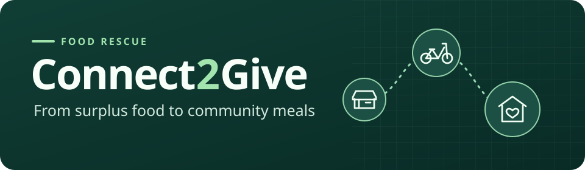

<p align="center">
  
</p>

# Connect2Give

Connect2Give helps restaurants donate surplus food, volunteers coordinate pickups, and NGOs receive and verify deliveries at collection camps.

**[Live demo](https://vaibhav0120.pythonanywhere.com/)** · [How it works](#how-it-works) · [Quick start](#quick-start) · [Deployment](#deployment)


## How it works

| Role | From listing to delivery |
| :--- | :--- |
| **Restaurants** | List surplus food with a quantity and pickup address. Track the status from the restaurant dashboard. |
| **Volunteers** | Accept donations, plan a pickup route, and bring collected food to an NGO camp. |
| **NGOs** | Open collection camps, register volunteers, and approve or reject submitted deliveries. |

A donation moves through **Pending pickup → Accepted → Collected → Awaiting verification → Delivered**. If the NGO rejects the delivery, the donation returns to **Collected** so the volunteer can submit it again.

The app uses Django templates and Django REST Framework. Leaflet and OpenStreetMap power the maps. Google sign-in, web push, and email can be configured through environment variables.

## Quick start

Use Python 3.12 for the commands below. The example configuration uses SQLite and prints outgoing email to the development console.

```powershell
git clone https://github.com/Vaibhavsh0120/Connect2Give.git
cd Connect2Give
py -3.12 -m venv .venv
.\.venv\Scripts\Activate.ps1
python -m pip install -r requirements.txt
Copy-Item .env.example .env
python manage.py migrate
python manage.py runserver
```

On macOS or Linux, use `python3.12 -m venv .venv`, `source .venv/bin/activate`, and `cp .env.example .env` in place of the PowerShell equivalents.

Open [the local app](http://127.0.0.1:8000/). To use the Django admin, run `python manage.py createsuperuser` and open [the admin dashboard](http://127.0.0.1:8000/admin/).

### Local checks

```bash
python manage.py check
python manage.py test
```

### Optional integrations

| Integration | Configuration |
| :--- | :--- |
| **MySQL** | Create a database, set `USE_SQLITE=False`, and fill in the `DB_*` settings. |
| **Google sign-in** | Set `GOOGLE_OAUTH_CLIENT_ID` and `GOOGLE_OAUTH_CLIENT_SECRET`. Register the app origin plus `/accounts/google/login/callback/` as an authorized redirect URI. |
| **Web push** | Generate a key pair with `python scripts/generate_keys.py` and configure the `VAPID_*` settings. |
| **SMTP** | Set `EMAIL_BACKEND=django.core.mail.backends.smtp.EmailBackend` and fill in the other `EMAIL_*` settings. Run `python -m scripts.check_email` to send a test message to your configured account. |

See [`.env.example`](.env.example) for the full template.

## Deployment

The [live demo](https://vaibhav0120.pythonanywhere.com/) is hosted on PythonAnywhere.

1. Point the Web app at `food_donation_project.wsgi` and select the virtual environment with the project dependencies.
2. Put the deployment `.env` next to `manage.py`. Set `DEBUG=False`, use a unique `SECRET_KEY`, and configure the production host and MySQL database.
3. Run `python manage.py migrate` and `python manage.py collectstatic --noinput`.
4. In the Web tab, map `/static/` to `staticfiles/` and `/media/` to `media/` using absolute paths. Reload the app.

Keep the plaintext `.env` and the age private identity outside Git. The local `agel` PowerShell function writes the encrypted backup to `.env.age` using `AGE_PUBLIC_KEY`.
